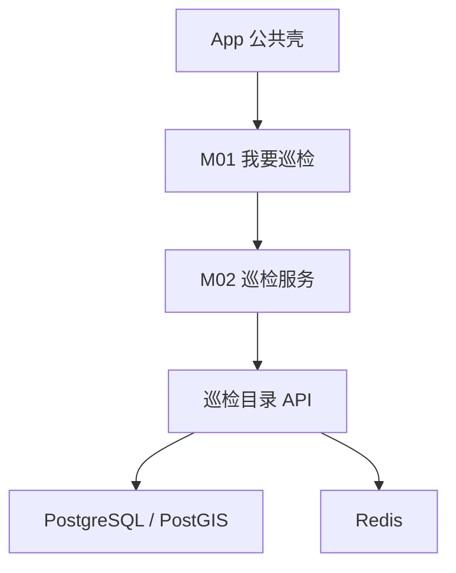

# 01｜模块化架构

## 1. 架构结论

本期采用“模块化单体 + 移动端功能模块”：

- 不拆微服务。
- 不引入 Nacos、Kafka、Elasticsearch。
- PostgreSQL 是事实数据源。
- Redis 只缓存可重建的目录数据。
- PostGIS 负责服务覆盖范围和距离排序。
- MinIO 只保存独立图片资源，不保存整页截图实现。

## 2. 上下文关系



公共壳提供：

- 底部导航。
- 当前城市。
- 登录上下文。
- 天气。
- 消息未读数。
- 客服。
- 路由、网络、日志和设计令牌。

巡检模块不得复制这些能力。

## 3. 移动端模块

```text
features/inspection/
├── public.ts
├── domain/
│   ├── entities/
│   │   ├── inspection-category.ts
│   │   ├── inspection-service.ts
│   │   └── portal-content.ts
│   ├── value-objects/
│   │   ├── catalog-query.ts
│   │   ├── money.ts
│   │   └── service-price.ts
│   └── repositories/
│       └── inspection-catalog-repository.ts
├── application/
│   ├── queries/
│   │   ├── get-inspection-portal.ts
│   │   ├── get-filter-options.ts
│   │   └── search-inspection-services.ts
│   └── ports/
│       └── inspection-host-action-port.ts
├── data/
│   ├── dto/
│   ├── mappers/
│   ├── sources/
│   └── repositories/
├── presentation/
│   ├── portal/
│   ├── catalog/
│   └── shared/
├── state/
├── navigation/
└── tests/
```

`public.ts` 只能导出：

- 两个页面的路由注册。
- `InspectionHostActionPort`。
- 必要的公共类型。

不得导出内部 store、DTO、私有组件或请求实现。

## 4. 页面路由壳

如果 uni-app 要求页面位于 `pages` 或分包目录，路由文件只承担生命周期桥接：

```text
pages-sub/inspection/
├── index.vue          # 装载 InspectionPortalPage
└── catalog/index.vue  # 装载 InspectionCatalogPage
```

禁止在路由文件中实现：

- API 请求拼装。
- 分类业务判断。
- 价格格式化。
- 距离算法。
- 大量页面组件。

## 5. 状态边界

### 公共状态

必须复用：

```text
currentCity
authContext
safeArea
networkStatus
```

### 巡检状态

建议：

```text
useInspectionPortalStore
useInspectionCatalogStore
```

`useInspectionPortalStore`：

- 当前入口配置快照。
- 配置版本和更新时间。
- 页面滚动恢复信息。
- 各区块加载/错误状态。

`useInspectionCatalogStore`：

- 查询条件。
- 当前列表与分页游标。
- 筛选项。
- 当前请求标识。
- 刷新/分页/错误状态。

不进入 Pinia：

- 输入框焦点。
- 筛选弹层打开状态。
- 临时筛选草稿。
- 单张图片加载状态。

## 6. 请求竞态策略

必须给每次目录查询生成 `requestKey`：

```text
city + keyword + category + sort + filters + page
```

规则：

1. 条件变化后旧请求被取消，或响应到达时因 key 不匹配被丢弃。
2. 刷新与分页不能同时写同一列表。
3. 只有第一页成功后才允许加载下一页。
4. 切换城市清理旧城市筛选项和服务数据。
5. 分页按服务 ID 去重。
6. 返回页面时可以先展示未过期快照，再后台刷新并标明刷新状态。

## 7. 服务端模块

```text
modules/inspection/
├── domain/
│   ├── model/
│   ├── repository/
│   └── policy/
├── application/
│   ├── query/
│   ├── dto/
│   ├── mapper/
│   └── facade/
├── infrastructure/
│   ├── persistence/
│   ├── cache/
│   ├── media/
│   └── location/
├── interfaces/
│   └── app-api/
├── migrations/
└── tests/
```

本期只提供 Query，不创建空 Command：

- `GetInspectionPortalQuery`
- `GetInspectionFilterOptionsQuery`
- `SearchInspectionServicesQuery`

后续管理端通过同一应用层新增 Command；不得让管理端直接操作目录表。

## 8. 服务端公开边界

其他模块只能通过以下方式访问：

- `InspectionCatalogFacade`。
- 本开发包定义的 REST API。
- 明确的只读领域查询接口。

禁止其他模块：

- 直接查询巡检表。
- 复用巡检 Mapper 拼接自己的 SQL。
- 直接读取 Redis 缓存键。
- 依赖巡检内部 DTO。

## 9. 缓存策略

适合缓存：

- 入口页配置。
- 当前城市的分类和筛选项。
- 热门服务摘要。

不建议直接缓存完整任意组合搜索结果，除非压测证明必要。

缓存键至少包含：

```text
inspection + resource + cityCode + configVersion + locale
```

规则：

- PostgreSQL 始终是事实来源。
- 缓存失败不能导致数据库数据丢失。
- 配置变化必须使相关缓存失效。
- 生产不得依赖手工清缓存才能显示新数据。

## 10. 图片与媒体适配

数据库只保存公共媒体资源 ID 或受控对象键。API 返回媒体 DTO：

```json
{
  "url": "https://cdn.example.com/...",
  "width": 1200,
  "height": 900,
  "alt": "电力输电线路无人机巡检"
}
```

不得返回：

- MinIO 内部 endpoint。
- 本机绝对路径。
- 永久公开的私有对象地址。
- 从整页参考图裁切的文字和按钮。

## 11. 宿主动作端口

```ts
export interface InspectionHostActionPort {
  openCitySelector(): Promise<ActionResult>
  openMessageCenter(): Promise<ActionResult>
  openCustomerService(): Promise<ActionResult>
  openInspectionServiceDetail(serviceId: string): Promise<ActionResult>
  startInspectionRequest(input: {
    cityCode: string
    categoryCode?: string
    serviceId?: string
  }): Promise<ActionResult>
  openRootTab(tab: 'HOME' | 'SERVICE' | 'DISCOVER' | 'MALL' | 'MINE'): Promise<ActionResult>
}

export type ActionResult =
  | { status: 'OPENED' }
  | { status: 'UNAVAILABLE'; message: string }
  | { status: 'LOGIN_REQUIRED' }
  | { status: 'FORBIDDEN'; message: string }
```

页面不得写死未实现的未来路由。

## 12. 依赖引入规则

下列能力优先用现有项目：

- HTTP 客户端。
- 取消请求机制。
- 图片组件。
- 日志。
- 埋点。
- 错误处理。
- 城市选择。
- 定位。
- UI 组件库。

如确需新增依赖，Codex 必须先报告：

- 使用目的。
- 包大小和影响端。
- 维护状态。
- 许可证。
- 是否支持微信小程序。
- 不引入时的替代方案。

