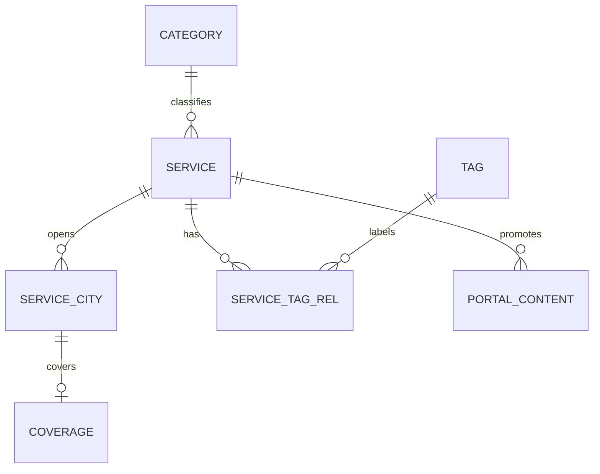

# 05｜PostgreSQL + PostGIS 数据模型

## 1. 总体原则

- PostgreSQL 是目录配置的事实来源。
- PostGIS 是 PostgreSQL 扩展，不是第二套数据库。
- 开发环境可用 Docker 本地运行。
- 正式环境部署在服务器或云数据库。
- 手机 App 不直接访问数据库。
- 所有结构变化通过迁移脚本完成。

## 2. 表关系



## 3. `inspection_category`

| 字段 | 类型建议 | 规则 |
| --- | --- | --- |
| id | uuid | 主键 |
| code | varchar(64) | 唯一稳定编码 |
| name | varchar(64) | 展示名 |
| subtitle | varchar(128) | 入口副标题 |
| icon_asset_id | uuid/varchar | 公共媒体资源 |
| sort_order | int | 默认顺序 |
| status | varchar(24) | ACTIVE/INACTIVE |
| version | int | 乐观锁 |
| created_at | timestamptz | 创建时间 |
| updated_at | timestamptz | 更新时间 |

分类不得只在前端硬编码。默认分类编码：

```text
POWER
PHOTOVOLTAIC
OIL_GAS
THERMAL
PARK
EQUIPMENT
PERIODIC
MORE
```

## 4. `inspection_service`

| 字段 | 类型建议 | 规则 |
| --- | --- | --- |
| id | uuid | 主键 |
| service_no | varchar(32) | 唯一业务编号 |
| category_id | uuid | 外键 |
| name | varchar(128) | 服务名称 |
| summary | varchar(256) | 卡片摘要 |
| cover_asset_id | uuid/varchar | 封面 |
| search_text | text | 可选搜索归一文本 |
| status | varchar(24) | DRAFT/ACTIVE/INACTIVE/ARCHIVED |
| version | int | 乐观锁 |
| created_at | timestamptz | 创建时间 |
| updated_at | timestamptz | 更新时间 |

不得将价格、城市开通和覆盖范围直接放在服务基础表。

## 5. `inspection_service_city`

| 字段 | 类型建议 | 规则 |
| --- | --- | --- |
| id | uuid | 主键 |
| service_id | uuid | 外键 |
| city_code | varchar(16) | 公共城市编码 |
| enabled | boolean | 当前城市可用 |
| price_mode | varchar(32) | 价格模式 |
| starting_price_minor | bigint | 人民币分，可为空 |
| currency | char(3) | 默认 CNY |
| unit_code | varchar(32) | KILOMETER/VISIT/PROJECT |
| display_order | int | 城市内顺序 |
| comprehensive_score | numeric | 综合排序权重 |
| is_hot | boolean | 入口热门 |
| available_from | timestamptz | 可选 |
| available_to | timestamptz | 可选 |
| version | int | 乐观锁 |
| created_at | timestamptz | 创建时间 |
| updated_at | timestamptz | 更新时间 |

约束：

- `service_id + city_code` 唯一。
- `PROJECT_QUOTE` 时 `starting_price_minor` 为空。
- 金额不得使用 float/double。

## 6. 标签

### `inspection_service_tag`

| 字段 | 说明 |
| --- | --- |
| id | 主键 |
| code | 稳定编码 |
| name | 展示名称 |
| tag_type | FEATURE/SERVICE_METHOD/DELIVERABLE |
| status | ACTIVE/INACTIVE |
| sort_order | 默认顺序 |

### `inspection_service_tag_relation`

| 字段 | 说明 |
| --- | --- |
| service_id | 服务 |
| tag_id | 标签 |
| sort_order | 卡片顺序 |

联合唯一：`service_id + tag_id`。

## 7. 入口配置

### `inspection_portal_content`

| 字段 | 类型建议 | 说明 |
| --- | --- | --- |
| id | uuid | 主键 |
| city_code | varchar(16), nullable | 空表示全国默认 |
| content_type | varchar(32) | HERO/GUARANTEE/PROCESS/PROMOTION |
| title | varchar(128) | 标题 |
| subtitle | varchar(256) | 副标题 |
| image_asset_id | uuid/varchar | 图片 |
| action_type | varchar(32) | 白名单动作 |
| action_payload | jsonb | 经过 Schema 校验的简单参数 |
| sort_order | int | 排序 |
| status | varchar(24) | ACTIVE/INACTIVE |
| version | int | 乐观锁 |
| created_at | timestamptz | 创建时间 |
| updated_at | timestamptz | 更新时间 |

`action_payload` 只允许稳定编码参数，如 `categoryCode`，不得下发任意 URL 或脚本。

城市配置不存在时，可以回退全国默认配置。

## 8. 覆盖范围

### `inspection_service_coverage`

| 字段 | 类型建议 | 说明 |
| --- | --- | --- |
| id | uuid | 主键 |
| service_city_id | uuid | 一对一或多范围 |
| coverage_geom | geometry(MultiPolygon,4326) | 覆盖区域 |
| center_point | geometry(Point,4326) | 可选展示中心 |
| distance_rule | varchar(32) | AREA_EDGE/CENTER_POINT |
| created_at | timestamptz | 创建时间 |
| updated_at | timestamptz | 更新时间 |

距离定义必须明确：

- `AREA_EDGE`：用户点到覆盖区域最短距离。
- `CENTER_POINT`：用户点到服务中心点距离。

不得在同一列表混用两种口径却不说明。

## 9. 统计读取

### `inspection_service_stats`

如果现有评价/订单模块已有聚合能力，优先通过只读接口获取，不重复建表。

若暂时需要目录侧快照：

| 字段 | 说明 |
| --- | --- |
| service_id | 服务 |
| city_code | 城市 |
| rating_average | 可为空 |
| rating_count | 真实评价数 |
| completed_count | 真实完成数 |
| updated_at | 统计时间 |

无真实数据时全部为空或零并由前端隐藏，禁止自动填入参考图数据。

## 10. 索引

最低要求：

- `inspection_category(code)` 唯一。
- `inspection_service(service_no)` 唯一。
- `inspection_service(category_id, status)`。
- `inspection_service_city(service_id, city_code)` 唯一。
- `inspection_service_city(city_code, enabled, display_order, service_id)`。
- `inspection_service_tag(code)` 唯一。
- `inspection_service_coverage` 的 GIST 空间索引。
- 服务名称、摘要、归一搜索文本的 `pg_trgm` GIN 索引（数据规模和语言验证后启用）。

所有排序以 `service_id` 作为最终稳定排序键，避免翻页重复/丢失。

## 11. 坐标

- 数据库存 WGS84，SRID 4326。
- 高德/腾讯地图可能使用 GCJ-02，必须由位置适配层转换。
- 坐标转换必须有单元测试和已知点校验。
- 经纬度顺序统一，接口与数据库映射不得颠倒。
- 不在普通日志输出精确用户位置。

## 12. 开发种子数据

允许在开发/测试环境提供以下分类和样例：

- 电力线路巡检。
- 光伏电站巡检。
- 燃气管道巡检（分类仍为 OIL_GAS）。
- 热力管网巡检。
- 园区综合巡检。

规则：

- 文件名或迁移名明确含 `dev`/`test`。
- 生产迁移不自动写入示例价格、评分和服务次数。
- 首批正式数据必须由业务方确认后单独导入。

## 13. 迁移与回滚

- 空库能完整执行迁移。
- PostGIS 扩展启用失败时给出明确部署说明，不静默降级距离排序。
- 回滚优先禁用新功能和保留数据，避免直接删除生产表。
- 迁移脚本、回滚说明和数据备份策略随增量交付。

