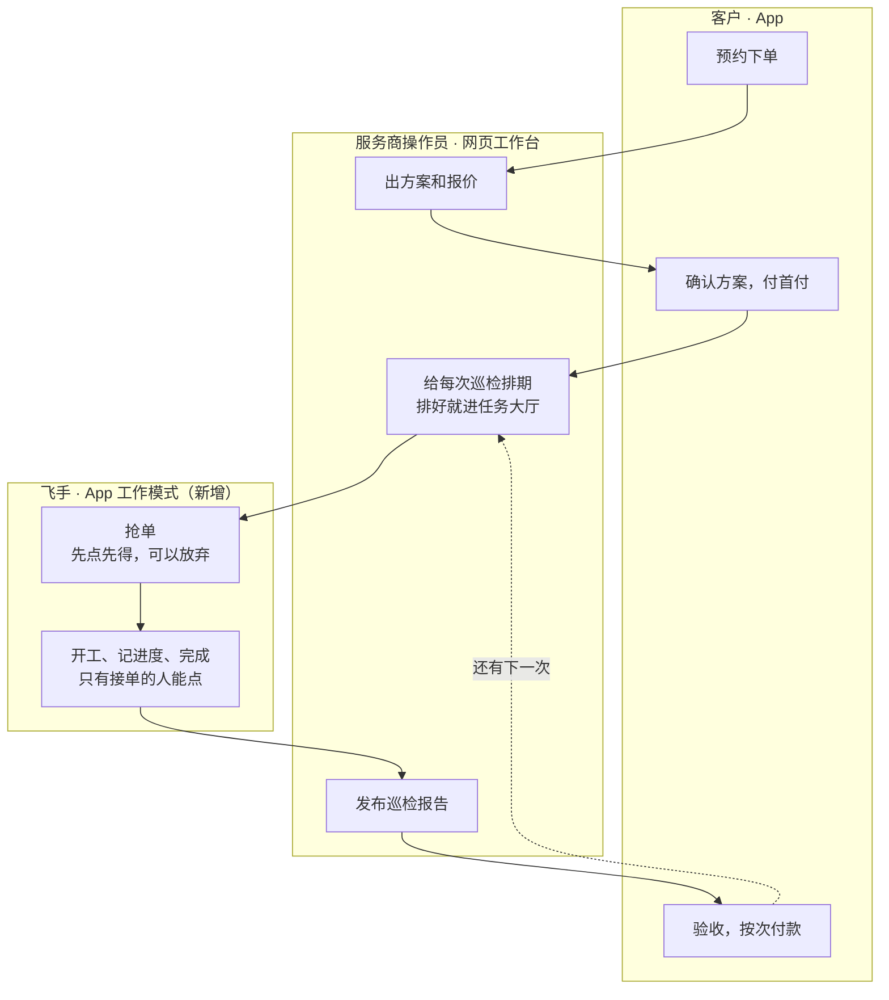

# 飞手端抢单设计方案

> 2026-11-24。用户已定做法：服务商内部抢单。状态：只有方案，还没开发。
> 在线版（带流程图）：https://claude.ai/artifact/E9C5jJv1mudhnY5MuabrKu

## 1. 方案一句话

客户照旧向服务商下单付款，服务商排好时间后，每一次巡检变成一个任务，出现在本机构飞手的“任务大厅”里，谁先点谁接。

- **要做的**：飞手账号、App 里的飞手端、抢单和放弃的规则、网页工作台的飞手管理和接单列。
- **不动的**：客户下单、方案报价、付款、验收。钱还是进服务商的商户号，平台不经手。
- **范围**：只做巡检。航拍、测绘等其他专业服务这次不接。

## 2. 抢单怎么走

只有飞手那两步是新的。其余六步现在就有，不改。

## 3. 抢单规则

一个任务就是一次巡检。一张订单有几次巡检就有几个任务，可以被不同飞手接走。

| 环节 | 规则 |
| --- | --- |
| 进大厅 | 首付已到账，操作员给这次巡检排了时间，还没人接 |
| 谁能看 | 只有本服务商的在职飞手。大厅里只显示服务名、时间、区县和巡检项目，不显示详细地址和客户联系方式 |
| 抢单 | 先点先得。两人同时点，后到的提示“已被接走” |
| 抢到之后 | 飞手能看到详细地址和现场联系人。客户的履约页自动显示这位飞手的名字和“持证”标记 |
| 放弃 | 开工前 2 小时以前可以放弃，任务回到大厅。过了这个时间只能找操作员收回 |
| 操作员指定和收回 | 操作员可以把任务直接指给某人，也可以在开工前收回重发 |
| 开工 | 只有接单的飞手或操作员能点。上一次巡检现场没完成时不能开工，这是现有规则，不变 |
| 记进度、现场完成 | 接单的飞手点，客户实时看到，并收到站内信 |
| 发布报告 | 仍由操作员在网页工作台做，飞手端不碰 |
| 客户改期 | 改期申请照旧由操作员确认。时间变了会通知接单飞手，此时可以不受限制地放弃 |
| 客户取消 | 订单取消后任务从大厅和飞手的列表里消失，并通知接单飞手 |

现有规则要求开工前订单上有人员和设备。改成抢单后，人员由抢单自动写入，设备由飞手开工时填。

## 4. 飞手账号

现在系统里没有飞手账号，“安排团队”里的飞手只是操作员手填的名字。要加的是：

- **角色**：身份模块加一个机构内角色“飞手”。一个飞手只属于一家服务商。
- **谁来加**：服务商操作员在网页工作台加，填姓名、手机号、执照类型、编号、有效期。平台不审核。
- **登录**：手机号加口令。初始口令创建时只显示一次，和平台给机构建账号的做法一样。
- **持证标记**：客户看到的“持证飞手”改为来自飞手资料，执照填了且没过期才显示，不再手勾。
- **停用**：停用后进不了飞手端，没开工的任务自动回到大厅。

## 5. 页面改动

飞手端放在 App 现有的“工作模式”入口里，那里现在只有场馆扫码核销。

| 在哪 | 页面 | 内容 | 新增还是改 |
| --- | --- | --- | --- |
| 飞手端 | 任务大厅 | 可抢的任务：服务名、时间、区县、巡检项目，下拉刷新，“抢单”按钮 | 新增 |
| 飞手端 | 我的任务 | 待开工、进行中、已完成三个页签 | 新增 |
| 飞手端 | 任务详情 | 地址、现场联系人、巡检项目、交付要求。按钮随状态变：抢单、放弃、开工、记进度、现场完成 | 新增 |
| 飞手端 | 开工确认 | 填或选这次用的设备，确认到场 | 新增 |
| 网页工作台 | 飞手管理 | 加飞手、改资料、停用 | 新增 |
| 网页工作台 | 巡检预约详情 | 每次巡检多一列“接单飞手”：待接、谁接了。加“指定”和“收回”两个按钮 | 改 |
| 网页工作台 | 安排团队对话框 | 人员由抢单自动写入，对话框只用来填设备和补充其他人员 | 改 |
| 客户 App | 履约页 | 版面不动。团队成员里自动出现接单飞手 | 不改 |

飞手端只在预览构建显示，加一个发布开关。原型里没有飞手端画板，样式照现有工作模式页做。

## 6. 接口与数据

开工、记进度、现场完成复用现有接口。抢单和飞手账号是新增。

**接口**

| 给谁用 | 接口 | 作用 | 新增还是复用 |
| --- | --- | --- | --- |
| 飞手 | `GET /api/v1/pilot/inspection/tasks` | 任务大厅和我的任务，按参数区分 | 新增 |
| 飞手 | `GET /api/v1/pilot/inspection/tasks/{visitId}` | 任务详情。没接单时不给地址和联系人 | 新增 |
| 飞手 | `POST …/tasks/{visitId}/claim` | 抢单 | 新增 |
| 飞手 | `POST …/tasks/{visitId}/release` | 放弃 | 新增 |
| 飞手 | `POST …/tasks/{visitId}/progress-events` | 开工、记进度、现场完成 | 复用现有命令，加飞手权限 |
| 操作员 | `/api/v1/provider/pilots` | 飞手的列表、新建、修改、停用 | 新增 |
| 操作员 | `PUT`、`DELETE …/visits/{visitId}/pilot` | 指定、收回 | 新增 |

新增的四个命令都带幂等键和版本号。服务端先锁住这次巡检再判断，保证只有一人抢到。

**契约**

- 新增 `contracts/openapi-inspection-pilot.yaml`，放飞手端和飞手管理的接口。
- `openapi-inspection-service-flow.yaml` 从 2.7.0 升到 2.8.0：每次巡检多一个“接单飞手”字段，加指定和收回。
- `openapi-notification.yaml` 加一类“任务提醒”。

**数据库**（编号按写方案时的最大号往后排，动手前先看一眼有没有被占）

| 模块 | 迁移 | 内容 |
| --- | --- | --- |
| 身份 | V015 | 新角色“飞手”和它的权限；新表“飞手资料”：所属机构、执照类型、编号、有效期、状态 |
| 巡检 | V016 | 巡检次加“接单飞手”“接单时间”“来源是抢的还是指定的”；新表“接单记录”，只追加，记每次抢、放弃、指定、收回 |
| 站内信 | V008 | 加“任务提醒”类别 |

**给飞手的站内信**

被指定、被收回、改期、取消，各发一条。新任务进大厅不发，飞手下拉刷新。

## 7. 这次不做

- 全平台抢单。飞手只能抢自己服务商的任务。
- 飞手个人收款、结算、计件工资。
- 新单推送、距离排序、导航。推送和地图都还没接真实服务商。
- 飞手上传照片和成果文件。进度先只写文字，报告仍由操作员发。
- 平台审核飞手资质。
- 航拍、测绘等其他专业服务。

## 8. 待定的事

没有另外说明就按“默认”做。

| 问题 | 默认 |
| --- | --- |
| 飞手怎么登录 | 手机号加口令。短信服务商定了再加验证码登录 |
| 任务什么时候进大厅 | 操作员排期之后 |
| 放弃的截止时间 | 开工前 2 小时 |
| 一个飞手一天能接几单 | 不限，操作员可以收回 |
| 设备谁填 | 飞手开工时填，操作员也能提前填 |
| 飞手能否看到客户电话 | 接单后能看到现场联系人电话，查看留记录 |

## 9. 怎么分步做

| 步骤 | 做什么 | 做完能看到 |
| --- | --- | --- |
| 1 账号 | 身份迁移、飞手管理页、App 工作模式里的飞手入口 | 操作员加一个飞手，飞手登录后看到空的任务大厅 |
| 2 抢单 | 巡检迁移、抢单放弃指定收回四个接口、任务大厅、我的任务、工作台的接单列 | 排期后任务出现在大厅。两个飞手同时抢，只有一个成功 |
| 3 现场 | 开工、记进度、现场完成接上飞手权限，开工时填设备 | 完整走通：抢单、开工、完成、操作员发报告、客户验收。客户履约页显示接单飞手 |
| 4 收尾 | 站内信、改期和取消的联动、端到端测试、更新文档 | 改期和取消后飞手端状态正确，测试全过 |

**先读这几处现有代码**

| 看什么 | 在哪 |
| --- | --- |
| 巡检次的状态和开工前置条件 | `backend/modules/inspection/src/main/java/com/lowaltitude/inspection/application/serviceflow/OrderApplicationService.java` |
| 操作员现在怎么安排和推进 | `apps/admin/src/features/inspection-workbench/` |
| App 工作模式怎么做的 | `apps/mobile/src/features/staff/` |
| 现有巡检接口 | `contracts/openapi-inspection-service-flow.yaml` |
| 机构成员和角色 | `backend/modules/identity/migrations/V001__identity_rbac.sql` |
