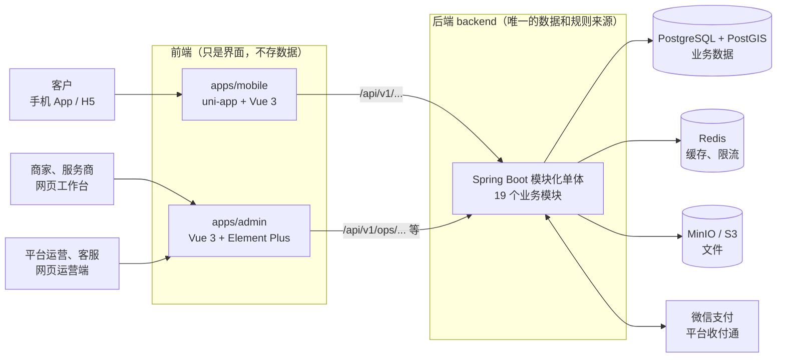
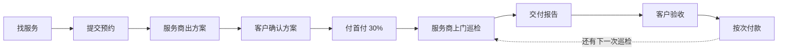
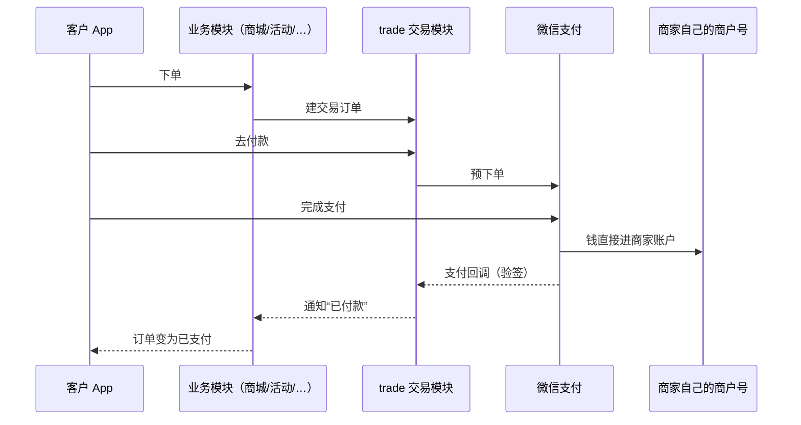

# 交接文档：10 分钟看懂这个项目

> 写给第一次接触本项目的人。只讲“是什么、在哪、怎么跑、现在到哪一步”。细节都有链接，用到再看。
> 更新：2026-11-24。

## 1. 这是什么

一个“低空经济 + 机器人”的综合服务平台，首个城市是东营。

用户在手机 App 上找无人机巡检等专业服务、报名赛事研学、预约体验馆、买或租设备、上课。商家和服务商在网页工作台接单。平台运营在同一个网页后台管城市、机构、商品和内容。

它是正式产品，不是演示。代码已写到可验收，但**还没接真实的支付和服务器**（见第 7 节）。

## 2. 一张图看懂系统



记住三句话：

- **一个后端，两个前端。** App 和网页后台调的是同一个后端、同一份数据。
- **前端不做决定。** 能不能下单、状态怎么变、钱多少，全由后端判断。
- **接口先写契约。** 前后端都照 `contracts/` 里的 OpenAPI 文件来，改接口先改契约。

## 3. 业务地图：用户能干什么，代码在哪

| 业务 | 用户能做什么 | 后端模块 |
| --- | --- | --- |
| 巡检（最早、最完整） | 找服务、预约、确认方案、分期付款、看履约、收报告、验收 | `inspection` |
| 其他专业服务 | 航拍、测绘、维护、技术支持：发需求、比报价、下单、验收 | `proservice` `demand` `serviceorder` |
| 赛事研学 | 报名（免费、收费）、候补、团队报名、凭证核销 | `activity` |
| 体验 | 预约体验馆场次、线上仿真体验 | `experience` |
| 商城 | 逛商品、购物车、下单、询价、售后 | `mall` |
| 租赁 | 租设备：询价、签约、交接、归还 | `rental` |
| 课程 | 买线上录播课、学习 | `course` |
| 发现 | 图文、视频、直播（只有观看端） | `content` `live` |
| 消息与客服 | 站内信、和平台或商家聊天 | `notification` `support` |
| **付款（所有业务共用）** | 微信支付、退款、对账 | `trade` |
| 账号与机构 | 登录、角色、机构资质、收货地址 | `identity` `account` |
| 其他 | 搜索、收藏对比、运营批量导入 | `search` `favorite` `opsimport` |

## 4. 两条最重要的流程

**巡检主流程**（项目的起点，其他服务订单都仿照它）：



**一笔钱怎么走**（所有业务都一样）：



- 钱**不经过平台**，直接进卖家自己的微信商户号。平台不分账、不抽佣。
- 只有 `trade` 模块能碰支付。别的模块不许自己连微信。
- 订单“已付款”只认微信的验签回调或后端主动查单，不认 App 说的。

## 5. 代码在哪

```text
backend/            后端（Java 21，Spring Boot 3.5，MyBatis-Plus）
  bootstrap/        启动工程；运营端接口 Ops*Controller 都在这
  modules/<模块>/    一个业务一个模块，各带自己的数据库迁移 migrations/
apps/mobile/        手机 App（uni-app，也能编成 H5）
  src/features/     一个业务一个目录，和后端模块对应
  src/pages/        页面入口，共 107 个页面
  e2e/              Playwright 端到端测试
apps/admin/         网页后台：平台运营端 + 商家/服务商工作台
contracts/          40 多份 OpenAPI 接口契约（前后端的共同依据）
infra/              本地开发、生产部署、导入模板、各种脚本
docs/               设计、计划、运维说明、交付文档
prototype/          可点击的页面原型（2026-11-14 修订版），页面样式以它为准
AGENTS.md           给 AI 编程助手定的开发规矩，也是范围总表
```

| 我想… | 去这里 |
| --- | --- |
| 改某个业务的后端逻辑 | `backend/modules/<模块>/` |
| 改 App 某个页面 | `apps/mobile/src/features/<业务>/presentation/` |
| 加一个运营端菜单 | 先读 `apps/admin/README.md` |
| 看某个页面该长什么样 | 用浏览器打开 `prototype/v2-20261114/index.html`，可以点着走 |
| 查某个接口长什么样 | `contracts/openapi-<业务>.yaml` |
| 加或改数据库表 | `backend/modules/<模块>/migrations/` 新增一个 `V00N__*.sql`，不改旧文件 |
| 控制某功能是否对外公开 | `apps/mobile/src/app-shell/release/release-features.json` |
| 部署到服务器 | `docs/ops/部署与回滚.md` 和 `infra/prod/` |

`AGENTS.md` 里写的原型路径 `.planning/prototype/v2-20261114` 是本机路径，仓库里对应的就是 `prototype/v2-20261114`。

每个 App 业务目录内部都是同样四层：`domain`（业务概念）→ `application`（用例）→ `data`（调接口）→ `presentation`（页面）。

## 6. 本地跑起来

需要：Docker、Node 20+、pnpm、Java 21、Maven。

**第一步：起后端和数据库**

```sh
cp .env.example .env     # 把所有 REPLACE_WITH_… 换成本机随便起的值；两个密钥按文件里的注释生成
docker compose --env-file .env -f infra/compose.yaml up -d --build
curl http://127.0.0.1:8080/actuator/health      # 返回 {"status":"UP"} 就好了
```

首次启动会自动建表并灌入开发示例数据。

**第二步：起 App（H5）**

```sh
pnpm install --store-dir ~/.pnpm-store    # 仓库 .npmrc 里的 store 路径是 Windows 的，Mac/Linux 要这样覆盖
```

新建 `apps/mobile/.env.local`：

```text
VITE_INSPECTION_API_BASE_URL=http://127.0.0.1:8080
VITE_INSPECTION_ALLOW_INSECURE_LOCAL_API=true
VITE_PLATFORM_PREVIEW_ENABLED=true
```

```sh
pnpm dev:h5      # 终端会打印访问地址
```

在终端打印的地址后加 `/dev/phone.html`，可在桌面浏览器按 390 × 844 的手机尺寸操作 App。窗口较小时会自动适配。保存 Vue 页面、组件或样式后，开发服务器会自动更新浏览器里的 App。直接打开 `/#/pages/home/index` 可以用整个浏览器窗口查看。

在项目根目录运行下面的命令，可固定使用 5182 端口，并在启动后自动打开手机预览。

```sh
npm --prefix apps/mobile run dev:h5 -- --host 127.0.0.1 --port 5182 --strictPort --open /dev/phone.html
```

把开发服务器的源地址（例如 `http://127.0.0.1:5182`）加进 `.env` 的 `INSPECTION_CORS_ALLOWED_ORIGINS` 并重启后端，否则浏览器会报跨域。

**第三步：起网页后台**

```sh
cd apps/admin && npm ci
ADMIN_API_TARGET=http://127.0.0.1:8080 npm run dev     # http://127.0.0.1:17430
```

**开发账号**（口令都是 `test-password`，只在开发环境存在）：

| 账号 | 身份 | 在哪登录 |
| --- | --- | --- |
| `dev-customer` | 客户 | App |
| `dev-merchant` | 商家（也能开直播） | 网页后台 |
| `dev-provider` | 巡检服务商 | 网页后台 |
| `dev-organizer` | 体验馆 | 网页后台、App 核销 |
| `dev-support` | 平台客服 | 网页后台 |
| `dev-operator` | 平台运营 | 网页后台。口令不在仓库里，启动后端时用环境变量 `DEV_OPERATOR_PASSWORD` 自己设 |

两点提醒：

- 上面的 compose 方式不带平台运营账号，也不能付款。要这两样，按 `infra/README.md` 直接跑 jar，并启动本机模拟微信支付。
- 以上步骤按仓库文档整理。写这份文档时实际验证过的是“直接跑 jar”的方式，compose 方式没有重新走一遍。

**跑测试**

```sh
mvn -f backend/pom.xml test                 # 后端
pnpm test && pnpm type-check                # App 单元测试、类型检查
cd apps/mobile && pnpm test:e2e             # App 端到端（要先起后端和 H5）
cd apps/admin && npm test                   # 网页后台
```

## 7. 现在到哪一步了

**做完的**

- 第 3 节表里的全部业务，App、后端、网页后台三端都有。
- 七个验收场景在本机完整演练通过，记录见 `docs/delivery/测试报告.md`。
- 生产部署脚本、备份恢复、运营手册、用户手册都已写好。

**还没接真的**（代码里是“适配器 + 本机模拟”，换成真的时只改适配器）

| 项 | 现状 |
| --- | --- |
| 微信支付 | 只对本机模拟跑通，没和真实微信联调。清单在 `docs/ops/微信支付联调清单.md` |
| 服务器、域名、HTTPS、备案 | 都还没有 |
| 直播、短信、推送、地图 | 服务商没定，只有本机模拟 |
| 示例图片和视频 | 来自原型，**没有使用授权**，只能内部预览。替换办法见 `docs/ops/授权图片替换.md` |
| App 上架 | 没做。安卓真机验收也还欠着 |

**明确不做的**：钱包、保证金、发票、分账抽佣、评价提交、微信小程序、无人机飞控。完整清单在 `AGENTS.md` 第 3 节。

## 8. 必须知道的六条规矩

1. **公开版只开巡检。** 其他业务都藏在“预览构建”后面，由发布开关控制。上线一个开一个。
2. **钱只走 `trade`。** 见第 4 节。
3. **改接口先改契约。** 契约、后端、前端三处要一致。
4. **数据库只加迁移，不改旧迁移。** 开发示例数据和正式迁移分开放，示例数据不会进生产。
5. **不写假数据。** 评分、销量、天气没有真实来源就不显示。页面上不留点了没反应的按钮。
6. **密钥不进仓库。** 都从环境变量来。仓库里只有 `.env.example`。

这个项目主要由 AI 编程助手按 `AGENTS.md` 开发。你用 AI 助手接着写时，让它先读 `AGENTS.md`。

## 9. 接下来读什么

| 顺序 | 文件 | 为什么读 |
| --- | --- | --- |
| 1 | `docs/redesign/01-概要设计.md` | 产品整体设计和已定的决策 |
| 2 | `AGENTS.md` 第 2、3 节 | 每个模块做了什么、不做什么 |
| 3 | `docs/delivery/用户操作手册.md`、`运营操作手册.md` | 从使用者角度走一遍功能 |
| 4 | `docs/redesign/08-后续开发计划.md` | 后面还要做什么 |
| 5 | `docs/delivery/交付清单.md` | 交付物和第三方服务一览 |
